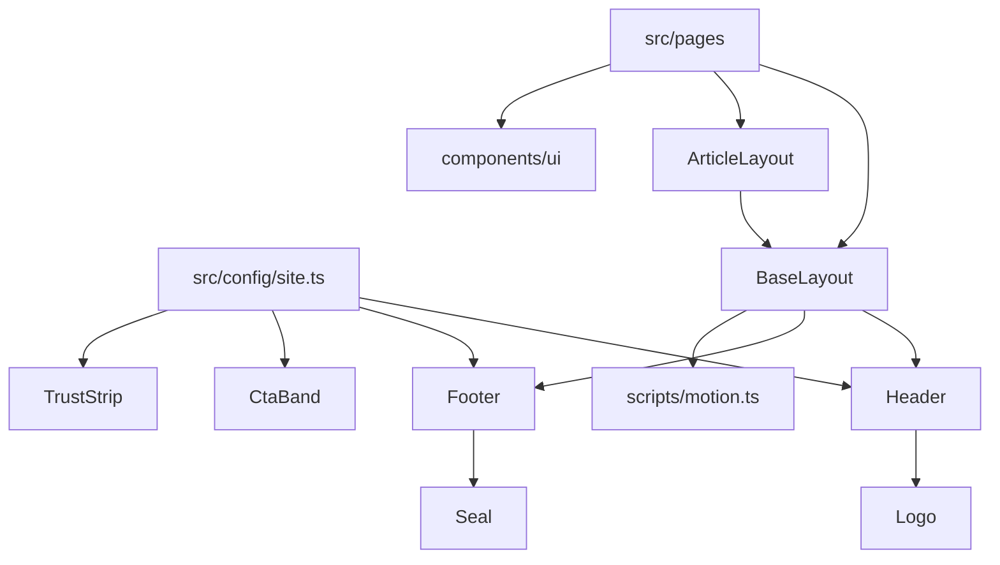
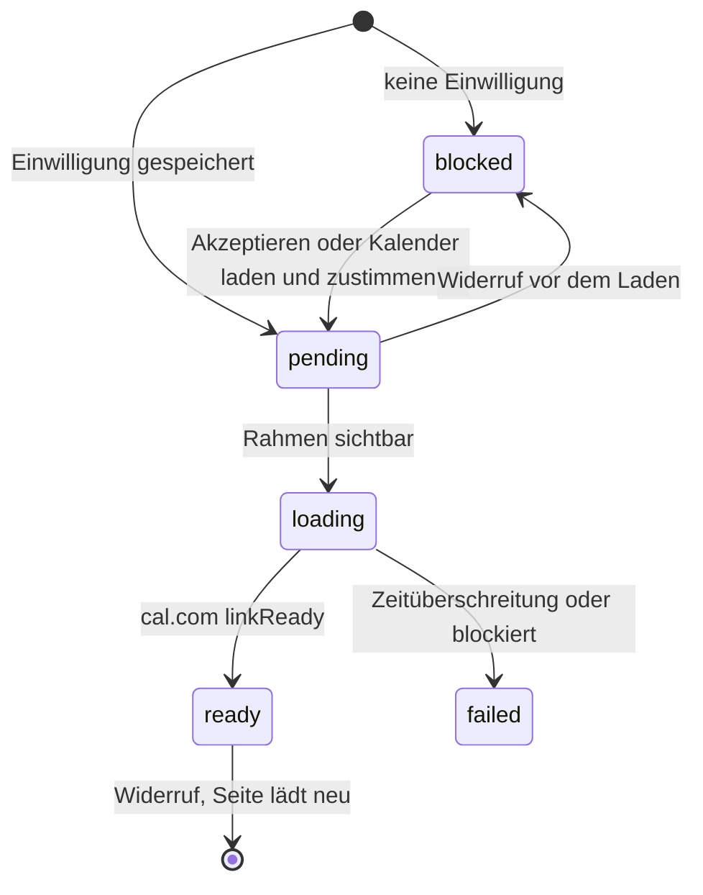
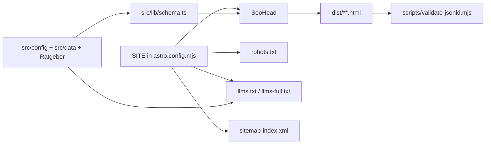

# tattoogutachten.de

Website des Sachverständigenbüros Wolf (Patrick Wolf, Bad Nauheim), Gutachten zu Tattoos und Piercings. Löst die bisherige Webador-Seite ab.

## Stack

- Astro 6, statische Ausgabe (`build.format: 'directory'`, `trailingSlash: 'always'`)
- Tailwind CSS 4 über `@tailwindcss/vite`, Konfiguration in CSS (`src/styles/global.css`)
- `@astrojs/sitemap`, `sharp` für die Bildverarbeitung
- TypeScript strict (`astro/tsconfigs/strict`), geprüft mit `@astrojs/check`
- Node 22.12 oder neuer
- Vite ist per `overrides` auf 7.3.3 festgelegt, weil `@tailwindcss/vite` 4.3 nicht mit Vite 8 läuft

## Befehle

| Befehl | Zweck |
|---|---|
| `npm install` | Abhängigkeiten installieren |
| `npm run dev` | Entwicklungsserver unter http://localhost:4321/tattoogutachten.de/ |
| `npm run check` | Typprüfung (`astro check`) |
| `npm run build` | Produktionsbuild nach `dist/` |
| `npm run preview` | Build lokal ansehen |
| `npm run validate:jsonld` | JSON-LD in `dist/` prüfen (nach dem Build, läuft auch im Deploy) |

## Struktur

| Pfad | Inhalt |
|---|---|
| `astro.config.mjs` | Konfiguration, Zieladresse der Seite in der Konstante `SITE` |
| `src/lib/url.ts` | `url()` setzt den Basispfad vor interne Links und Dateien aus `public/` |
| `src/config/site.ts` | Kontaktdaten, Navigation, Nachweise (Registernummer, Gericht). Einzige Quelle, nie im Markup wiederholen |
| `src/config/practice.ts` | Angaben, die nur der Betreiber bestätigen kann (Gesprächsform, Antwortzeit, Fahrtkosten und mehr). Felder bleiben `null`, bis sie bestätigt sind; erst dann erscheinen sie auf der Seite |
| `src/lib/primary-cta.ts` | Ziel und Text des Seiten-CTA in Header, Menü und mobiler Leiste: Terminbuchung, auf den Seiten für Rechtsanwälte, Gerichte und Gerichtsgutachten die Anfrage über die Kontaktdaten |
| `src/data/enquiry.ts` | Hinweise vor der Anfrage (Frist, Vertraulichkeit, Unterlagen), gezeigt neben Kalender und Kontaktwegen |
| `src/layouts/BaseLayout.astro` | HTML-Gerüst mit `lang="de"`, Schriften, Sprunglink, Header, Footer, Slot `head` für SEO |
| `src/layouts/ArticleLayout.astro` | Langtext (Ratgeber, Rechtstexte) mit Brotkrumen, Randspalte und `prose-report` |
| `src/components/layout/` | `Header` (mit mobilem Menü), `Footer`, `Logo` |
| `src/components/ui/` | Bausteine, siehe Designsystem |
| `src/scripts/motion.ts` | Scroll Reveal und Parallaxe |
| `src/styles/global.css` | Design Tokens (`@theme`), Basisstile, Bewegung |
| `src/assets/images/` | Fotos, Siegel, Abzeichen für `astro:assets` (nie das KI-Banner aus `docs/`) |
| `src/components/seo/SeoHead.astro` | Title, Description, Canonical, Robots, Open Graph, Twitter, JSON-LD Graph |
| `src/lib/schema.ts` | JSON-LD Entitäten und Bausteine, verknüpft über `@id` |
| `src/lib/llms.ts` | Inhalt von `llms.txt` und `llms-full.txt` |
| `src/pages/` | Seiten, dazu `robots.txt.ts`, `llms.txt.ts`, `llms-full.txt.ts`, `404.astro` |
| `scripts/validate-jsonld.mjs` | Prüft das JSON-LD im Build |
| `scripts/og-image/` | Vorlage und Renderskript des Vorschaubilds `public/og/tattoogutachten-og.png` |
| `docs/source-content/` | Inhalte und Bilder der alten Seite, nur als Quelle |

## Designsystem

Leitidee: ein sachverständiges Gutachten auf warmem Papier, gesetzt in tiefem Schwarz, mit einem Akzent aus dem Rot des DGuSV-Siegels und einem Hauch Messing aus dem RW-Abzeichen. Haarlinien, Randnotizen, asymmetrisches Raster. Keine dekorativen Nummern (kein 01, 02 vor Karten, Leistungen oder Abschnitten); Nummern gibt es nur bei echten Abläufen (`Steps`).

| Token | Wert | Einsatz |
|---|---|---|
| `paper` / `paper-deep` | `#f4efe6` / `#ebe3d5` | Flächen |
| `ink` | `#17140f` | Text, dunkle Bänder, Footer |
| `graphite` | `#57504a` | Nebentext (6,9:1 auf `paper`) |
| `rule` | `#cfc3ae` | Haarlinien |
| `oxblood` / `signal` | `#8c1d1b` / `#b8211c` | Akzent, Hover, Fokusring, sparsam |
| `brass` / `brass-light` | `#a8843f` / `#d2b277` | kleine Details, Icons auf `ink` |

Schriften, selbst gehostet aus `@fontsource-variable` über die Fonts API von Astro (`astro.config.mjs`, Anbieter `local`): Newsreader (Serif mit Kursive, Überschriften und Zitate) und Schibsted Grotesk (Fließtext, Labels). Nur das Subset latin, die normalen Schnitte werden vorgeladen, Astro erzeugt metrisch angepasste Ersatzschriften gegen Layoutverschiebung.

Bausteine in `src/components/ui/`:

| Komponente | Zweck |
|---|---|
| `Container`, `Section` | Raster; `Section` mit Label, Randnotiz (Slot `note`), Titel, Intro, Ton `paper`, `deep`, `ink`. Dichte `chapter` (Hauptkapitel) oder `support` (kurze Ergänzungen, weniger Abstand, kleinerer Titel). `axis` setzt den Inhalt unter den Titel (Leseachse nach der dreispaltigen Randspalte, Klasse `.axis`); ohne `axis` nur für Raster, die bewusst die ganze Breite nutzen. Töne nach Zweck: Erzählung auf `paper`, Nachschlage- und Arbeitsmaterial auf `deep` |
| `Eyebrow` | Label im Berichtsstil mit kurzer Akzentlinie |
| `Button` | Link oder Button, Varianten `primary`, `secondary`, `inverse`, `text`, SVG-Icon statt Pfeilzeichen |
| `Card` | Zielgruppen und Leistungen, ganze Karte klickbar; `rule` (Standard, transparent unter einer Linie) oder `panel` (gefüllte Fläche mit Innenabstand), je Gruppe nur eine Form |
| `Quote`, `Steps`, `Faq`, `Checklist`, `KeyFacts` | Zitat, Ablauf mit Vorbereitungshinweis, FAQ auf `details`/`summary`, Checkliste, Kostenerklärung |
| `CourtReference`, `TrustStrip`, `Seal` | Gerichtsbestellung mit Rechtshinweis, Nachweise (Zertifizierung mit Registernummer, Erfahrung, Gerichtsbestellung vorn), Siegel |
| `ExpertCard` | Kompakte Zuordnung neben Leistungs- und Zielgruppentext: Porträt, Name, zwei Kernfakten, Link zur Qualifikation |
| `CtaBand`, `Breadcrumbs` | Abschluss mit Terminbuchung, Brotkrumen |
| `ArtImage` | Bild mit Bildausschnitt je Breakpoint (`crops`), `width`/`height` je `source`, optional Parallaxe |
| `MeasureRule`, `NeedleLine`, `Icon` | Dekor (Maßband, Linienzug) und Icons als SVG |

Überschriften: `h1`, `h2` und die Display-Größen trennen nicht automatisch. Zu lange Komposita für schmale Telefone bekommen in `src/lib/display-breaks.ts` eine weiche Trennstelle, die `PageHeader` und `Section` beim Rendern einsetzen.

Mobile Buchungsleiste: bleibt verborgen, solange `[data-primary-action]` (Aktionen im Seitenkopf oder Titelblock) sichtbar oder noch darunter ist, und während Kalender, abschließendes Band (`[data-cta-band]`) oder Footer im Bild sind.

Bewegung: `data-reveal` (Standard, `rule`, `image`, `draw`) plus `data-reveal-group` für gestaffelte Einblendung, `data-parallax` für Bilder. Startzustände greifen nur, wenn das Inline-Skript `html.js` gesetzt hat und keine reduzierte Bewegung gewünscht ist. Ohne JS ist alles sichtbar, das Menü steht dann als Liste unter dem Header. Seitenwechsel blenden über CSS View Transitions über.



## Einwilligung (Cookie-Einstellungen)

Selbst gebaut, ohne CMP. Einzige optionale Kategorie ist die Terminbuchung über cal.com; Statistik gibt es nicht, also wird sie nicht angeboten.

| Teil | Datei |
|---|---|
| Schlüssel, Fassung, Kategorien | `src/config/consent.ts` (`tg-consent` im localStorage: Fassung, Zeitpunkt, Auswahl) |
| Zustand und Ereignisse | `src/scripts/consent.ts` |
| Hinweis und Einstellungen | `src/components/layout/ConsentDialog.astro`, modaler `dialog` als Bottom Sheet, Fokus gefangen, Escape schließt ohne Entscheidung |
| Platzhalter im Kalenderrahmen | `src/components/booking/BookingEmbed.astro` (Zustand `blocked`, Schaltfläche Kalender laden und zustimmen) |
| Laden nach Einwilligung, Neuladen nach Widerruf | `src/scripts/booking.ts` |
| Link Cookie-Einstellungen | Footer jeder Seite, ohne JS Sprung zu `/datenschutz/#einwilligung` |



Der Hinweis öffnet sich automatisch, solange keine Wahl der aktuellen `CONSENT_VERSION` gespeichert ist, außer auf Datenschutz und Impressum. Bei inhaltlicher Änderung von Zweck, Empfänger oder Text `CONSENT_VERSION` erhöhen und die Datenschutzerklärung anpassen. Den Status von Cal.com, Inc. im EU-U.S. Data Privacy Framework vor jeder Änderung prüfen (dataprivacyframework.gov, Teilnehmer 2960).

## Offene Punkte vor dem Livegang

Diese Angaben fehlen, weil nur Patrick Wolf sie liefern kann. Nichts davon wird geraten; die Struktur steht, der Wert kommt in `src/config/practice.ts` oder in die genannte Datei.

| Punkt | Wohin | Wirkung |
|---|---|---|
| Eigenes cal.com Ereignis (Gastgeber, 60 Minuten, Pflichtfelder, Bestätigungstext), dann Testbuchung mit Verschieben und Absagen | `PUBLIC_CAL_LINK` beim Build | Demo-Hinweis verschwindet, Abschlussbänder und Ratgeber führen wieder mit dem Kalender statt mit dem Telefon (`CAL_IS_DEMO`) |
| Form der Erstberatung (Telefon, Video oder vor Ort, wer ruft an) | `consultationMethod` | Zeile über beiden Kalendern und auf `/termin/` |
| Wie Fotos und Unterlagen nach der Buchung übermittelt werden | `documentHandover` | Hinweis Unterlagen |
| Antwortzeit auf Anrufe und E-Mails | `responseTime` | Hinweis Frist |
| Übliche Bearbeitungszeit eines Gutachtens mit Bedingungen | `reportTurnaround` | Ablauf und Kosten, FAQ zur Dauer |
| Besuche im Büro nur mit Termin? | `officeVisits` | Kontaktseite bei der Anschrift |
| Umgang mit früheren Berührungspunkten zu Studio oder Beteiligten | `conflictHandling` | Startseite, Über mich, FAQ zur Unabhängigkeit |
| Fahrtkosten, Umsatzsteuer, Honorar oder Beispielrahmen | `travelCosts`, `vat`, `rate` | Kostenübersicht |
| Verfügbarkeit für Gerichtsaufträge | `courtAvailability` | `/fuer-gerichte/` |
| Eigenes Postfach des Sachverständigenbüros statt der Studioadresse | `contact.email` in `src/config/site.ts` | überall |
| Datum der Zertifizierung, Link auf einen offiziellen Registereintrag | `credentials` in `src/config/site.ts` | Nachweise auf `/ueber-mich/`. Der Eintrag auf deutsche-gutachterauskunft.de nennt eine andere Anschrift und Rechtsberatung als Schwerpunkt und wird deshalb nicht verlinkt |
| Antwort zu Piercing-Fotos und Unterlagen bei Hygienefragen bestätigen | `faqVariants` in `src/data/faq.ts` | Fragen auf Piercing- und Hygieneseite |

## Basispfad und Links

Die Seite läuft vorerst unter https://digitalfreedom-co-za.github.io/tattoogutachten.de/, also mit dem Basispfad `/tattoogutachten.de`. Interne Links und Dateien aus `public/` deshalb nie als festen Pfad schreiben, sondern immer über den Helfer:

```astro
---
import { url } from '../lib/url';
---
<a href={url('/kontakt')}>Kontakt</a>

```

Bilder aus `src/assets/` über `astro:assets` bekommen den Basispfad automatisch.

## SEO und GEO

Jede Seite bekommt ihre Tags aus `SeoHead` (über `BaseLayout`): eindeutiger Title und Description, Canonical, Robots, Open Graph und Twitter mit dem Vorschaubild (1200 x 630) sowie genau einen JSON-LD Block. Alle absoluten Adressen entstehen aus `Astro.site` plus Basispfad, also aus `SITE` in `astro.config.mjs`.



Der JSON-LD Graph jeder Seite: `WebSite`, das Büro als `LocalBusiness` (Anschrift, Geo, Einsatzgebiet Deutschland und EU, Leistungskatalog), die betreibende `Organization` (RuW Lifestyle GmbH), `Person` Patrick Wolf (`memberOf` DGuSV und Bundesverband Tattoo, `hasCredential` mit Registernummer), das Vorschaubild, dazu `WebPage` und `BreadcrumbList` der Seite. Seitenbezogen kommen `Service` (Leistungsseiten), `FAQPage` (Häufige Fragen, aus `src/data/faq.ts`), `Article` (Ratgeber), `AboutPage`, `ContactPage`, `CollectionPage` und die Buchungsaktion auf `/termin/` hinzu. Neue Seiten geben `breadcrumbs`, optional `pageType`, `page` und `schema` an `BaseLayout`, nie ein eigenes JSON-LD.

Name, Anschrift und Telefon stehen nur in `src/config/site.ts` und werden überall daraus gelesen, damit sie identisch bleiben.

### Indexierung: ein Schalter

Die Vorschau auf github.io bleibt `noindex`, damit vor dem Umzug kein doppelter Inhalt entsteht. Gesteuert wird das über eine Variable:

| `PUBLIC_INDEXABLE` | Wirkung |
|---|---|
| nicht gesetzt oder `false` (Standard, Vorschau) | Jede Seite trägt `noindex`. `robots.txt` erlaubt das Crawlen trotzdem, damit Suchmaschinen das `noindex` sehen. Sitemap wird erzeugt. |
| `true` (Start auf der eigenen Domain) | Alle Seiten einschließlich `/termin/` sind indexierbar (`index, follow`). |

Gesetzt wird sie in `.github/workflows/deploy.yml` (`env.PUBLIC_INDEXABLE`), lokal per `PUBLIC_INDEXABLE=true npm run build`. Sitemap und `robots.txt` listen in beiden Modi dieselben Seiten, nur die 404-Seite ist nie indexierbar und fehlt in der Sitemap.

Hinweis: Auf github.io liegt `robots.txt` unter dem Basispfad, Crawler lesen sie dort nicht aus. Wirksam wird sie mit der eigenen Domain im Wurzelverzeichnis.

### Vorschaubild

`public/og/tattoogutachten-og.png` ist eingecheckt. Nach Änderungen an Gestaltung oder Fakten neu erzeugen: `scripts/og-image/render.sh` (headless Chrome, nutzt die Schriften aus `node_modules` und die Fotos aus `src/assets/images`).

## Deploy

`.github/workflows/deploy.yml` läuft bei jedem Push auf `main` (und manuell über `workflow_dispatch`): `npm ci`, `astro check`, `astro build`, `npm run validate:jsonld`, danach `upload-pages-artifact` und `deploy-pages`. GitHub Pages steht im Repository auf Quelle GitHub Actions.

### Cache-Header

GitHub Pages liefert alles mit `Cache-Control: max-age=600` aus, auch die Dateien unter `/_astro/`, und lässt keine eigenen Header zu (geprüft am 12.11.2026). Die Dateien unter `/_astro/` tragen einen Inhalts-Hash im Namen und ändern sich nie. Sobald die Seite hinter einem Hoster oder CDN mit konfigurierbaren Antwort-Headern liegt, gilt:

| Pfad | Header |
| --- | --- |
| `/_astro/*` | `Cache-Control: public, max-age=31536000, immutable` |
| HTML, `sitemap*.xml`, `robots.txt`, `llms*.txt` | `Cache-Control: public, max-age=0, must-revalidate` |

Unter dem Basispfad der Vorschau lautet der erste Pfad `/tattoogutachten.de/_astro/*`.

## Umzug auf die eigene Domain

1. In `astro.config.mjs` die Konstante `SITE` auf `{ url: 'https://www.tattoogutachten.de', base: '/' }` setzen.
2. `public/CNAME` mit der Zeile `www.tattoogutachten.de` anlegen.
3. DNS bei INWX auf GitHub Pages zeigen lassen und in den Pages-Einstellungen HTTPS erzwingen.
4. In `.github/workflows/deploy.yml` `PUBLIC_INDEXABLE: 'true'` setzen, danach Sitemap in der Search Console und bei Bing einreichen.

Weil alle Pfade über `url()` laufen, sind sonst keine Änderungen nötig.
