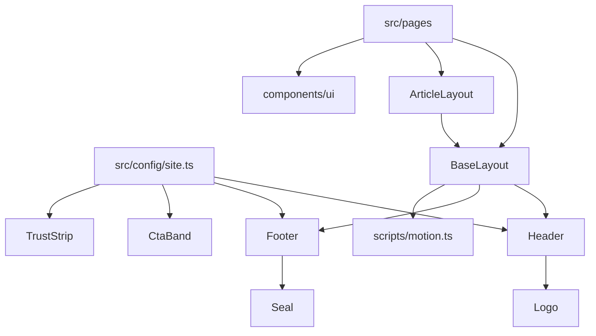

# tattoogutachten.de

Website des Sachverständigenbüros Wolf (Patrick Wolf, Bad Nauheim), Gutachten zu Tattoos und Piercings. Löst die bisherige Webador-Seite ab.

## Stack

- Astro 6, statische Ausgabe (`build.format: 'directory'`, `trailingSlash: 'always'`)
- Tailwind CSS 4 über `@tailwindcss/vite`, Konfiguration in CSS (`src/styles/global.css`)
- `@astrojs/sitemap`, `sharp` für die Bildverarbeitung
- TypeScript strict (`astro/tsconfigs/strict`), geprüft mit `@astrojs/check`
- Node 22.12 oder neuer
- Vite ist per `overrides` auf 7.3.3 festgelegt, weil `@tailwindcss/vite` 4.3 nicht mit Vite 8 läuft

## Befehle

| Befehl | Zweck |
|---|---|
| `npm install` | Abhängigkeiten installieren |
| `npm run dev` | Entwicklungsserver unter http://localhost:4321/tattoogutachten.de/ |
| `npm run check` | Typprüfung (`astro check`) |
| `npm run build` | Produktionsbuild nach `dist/` |
| `npm run preview` | Build lokal ansehen |

## Struktur

| Pfad | Inhalt |
|---|---|
| `astro.config.mjs` | Konfiguration, Zieladresse der Seite in der Konstante `SITE` |
| `src/lib/url.ts` | `url()` setzt den Basispfad vor interne Links und Dateien aus `public/` |
| `src/config/site.ts` | Kontaktdaten, Navigation, Nachweise (Registernummer, Gericht). Einzige Quelle, nie im Markup wiederholen |
| `src/layouts/BaseLayout.astro` | HTML-Gerüst mit `lang="de"`, Schriften, Sprunglink, Header, Footer, Slot `head` für SEO |
| `src/layouts/ArticleLayout.astro` | Langtext (Ratgeber, Rechtstexte) mit Brotkrumen, Randspalte und `prose-report` |
| `src/components/layout/` | `Header` (mit mobilem Menü), `Footer`, `Logo` |
| `src/components/ui/` | Bausteine, siehe Designsystem |
| `src/scripts/motion.ts` | Scroll Reveal und Parallaxe |
| `src/styles/global.css` | Design Tokens (`@theme`), Basisstile, Bewegung |
| `src/assets/images/` | Fotos, Siegel, Abzeichen für `astro:assets` (nie das KI-Banner aus `docs/`) |
| `src/pages/` | Seiten |
| `docs/source-content/` | Inhalte und Bilder der alten Seite, nur als Quelle |

## Designsystem

Leitidee: ein sachverständiges Gutachten auf warmem Papier, gesetzt in tiefem Schwarz, mit einem Akzent aus dem Rot des DGuSV-Siegels und einem Hauch Messing aus dem RW-Abzeichen. Haarlinien, Berichtsnummerierung (01, 02, Abb. 01), Randnotizen, asymmetrisches Raster.

| Token | Wert | Einsatz |
|---|---|---|
| `paper` / `paper-deep` | `#f4efe6` / `#ebe3d5` | Flächen |
| `ink` | `#17140f` | Text, dunkle Bänder, Footer |
| `graphite` | `#57504a` | Nebentext (6,9:1 auf `paper`) |
| `rule` | `#cfc3ae` | Haarlinien |
| `oxblood` / `signal` | `#8c1d1b` / `#b8211c` | Akzent, Hover, Fokusring, sparsam |
| `brass` / `brass-light` | `#a8843f` / `#d2b277` | kleine Details, Icons auf `ink` |

Schriften, selbst gehostet aus `@fontsource-variable` über die Fonts API von Astro (`astro.config.mjs`, Anbieter `local`): Newsreader (Serif mit Kursive, Überschriften und Zitate) und Schibsted Grotesk (Fließtext, Labels). Nur das Subset latin, die normalen Schnitte werden vorgeladen, Astro erzeugt metrisch angepasste Ersatzschriften gegen Layoutverschiebung.

Bausteine in `src/components/ui/`:

| Komponente | Zweck |
|---|---|
| `Container`, `Section` | Raster; `Section` mit Nummer, Label, Randnotiz (Slot `note`), Titel, Intro, Ton `paper`, `deep`, `ink` |
| `Eyebrow` | Label im Berichtsstil, optional mit Nummer |
| `Button` | Link oder Button, Varianten `primary`, `secondary`, `inverse`, `text`, SVG-Icon statt Pfeilzeichen |
| `Card` | Zielgruppen und Leistungen, ganze Karte klickbar |
| `Quote`, `Steps`, `Faq`, `Checklist`, `KeyFacts` | Zitat, Ablauf mit Vorbereitungshinweis, FAQ auf `details`/`summary`, Checkliste, Kostenerklärung |
| `CourtReference`, `TrustStrip`, `Seal` | Gerichtsbestellung mit Rechtshinweis, Nachweise mit Registernummer, Siegel |
| `CtaBand`, `Breadcrumbs` | Abschluss mit Terminbuchung, Brotkrumen |
| `ArtImage` | Bild mit Bildausschnitt je Breakpoint (`crops`), `width`/`height` je `source`, optional Parallaxe |
| `MeasureRule`, `NeedleLine`, `Icon` | Dekor (Maßband, Linienzug) und Icons als SVG |

Bewegung: `data-reveal` (Standard, `rule`, `image`, `draw`) plus `data-reveal-group` für gestaffelte Einblendung, `data-parallax` für Bilder. Startzustände greifen nur, wenn das Inline-Skript `html.js` gesetzt hat und keine reduzierte Bewegung gewünscht ist. Ohne JS ist alles sichtbar, das Menü steht dann als Liste unter dem Header. Seitenwechsel blenden über CSS View Transitions über.



## Basispfad und Links

Die Seite läuft vorerst unter https://digitalfreedom-co-za.github.io/tattoogutachten.de/, also mit dem Basispfad `/tattoogutachten.de`. Interne Links und Dateien aus `public/` deshalb nie als festen Pfad schreiben, sondern immer über den Helfer:

```astro
---
import { url } from '../lib/url';
---
<a href={url('/kontakt')}>Kontakt</a>

```

Bilder aus `src/assets/` über `astro:assets` bekommen den Basispfad automatisch.

## Deploy

`.github/workflows/deploy.yml` läuft bei jedem Push auf `main` (und manuell über `workflow_dispatch`): `npm ci`, `astro check`, `astro build`, danach `upload-pages-artifact` und `deploy-pages`. GitHub Pages steht im Repository auf Quelle GitHub Actions.

## Umzug auf die eigene Domain

1. In `astro.config.mjs` die Konstante `SITE` auf `{ url: 'https://www.tattoogutachten.de', base: '/' }` setzen.
2. `public/CNAME` mit der Zeile `www.tattoogutachten.de` anlegen.
3. DNS bei INWX auf GitHub Pages zeigen lassen und in den Pages-Einstellungen HTTPS erzwingen.

Weil alle Pfade über `url()` laufen, sind sonst keine Änderungen nötig.
